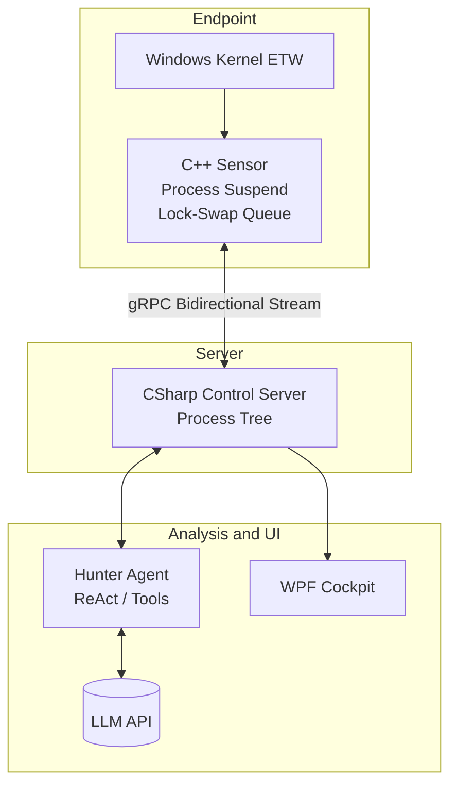
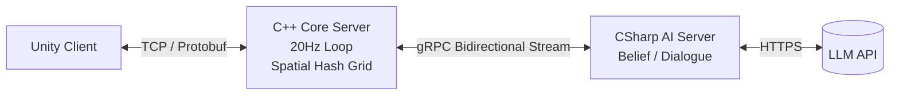

# Jin (naneunmuneo)

## About Me
C++와 C#으로 Windows 소프트웨어를 개발합니다.
현재 정적 분석 도구 [ARQA Static](https://kocome.com/solution)을 개발하고 있습니다.

업무 밖에서는 Windows 시스템 내부 구조와 동시성 설계에 관심을 두고, 커널 이벤트 기반 EDR과 멀티스레드 에이전트 시뮬레이션 서버를 직접 만들고 있습니다.

- **관심 분야**
  - Windows 시스템: ETW 커널 이벤트 수집, Win32/NT API 기반 프로세스·메모리 제어
  - 정적 분석: LLVM/Clang 기반 취약점 탐지와 코드 메트릭 분석
  - 동시성: 락 대기 시간을 줄이는 스레드 구조와 비동기 통신(gRPC)
  - AI 연동: 도구 호출(Tool Calling) 기반 LLM 에이전트를 시스템에 안전하게 붙이는 방법

---

## Tech Stack

### Languages
 

### Windows Internals
  

### Static Analysis & Compiler

### Networking & IPC
   

### Architecture & Profiling
 

### Data & AI
  

### Frameworks & Build
    

---

## Personal Projects

### [Phalanx-EDR](https://github.com/jin20203458/phalanx-edr) - Windows EDR with LLM Threat Analysis
*ETW로 수집한 커널 이벤트를 바탕으로 의심 프로세스를 멈추고, LLM 에이전트가 조사해 종료 여부를 판단하는 개인 EDR 프로젝트*

- **C++ 센서**: ETW(Kernel-Process 프로바이더)로 프로세스 이벤트를 실시간 수집. 이벤트 콜백 스레드가 막히지 않도록 락-스왑 큐로 수집과 처리를 분리.
- **프로세스 제어**: 의심 프로세스를 `NtSuspendProcess`로 일시 정지. 조사가 제한 시간을 넘기면 워치독이 자동으로 재개시켜 시스템이 멈춘 채 남지 않도록 설계.
- **조사 에이전트**: VAD 순회로 파일에 매핑되지 않은 실행 메모리(Unbacked Memory)를 찾는 등 조사 도구를 LLM 에이전트에 연결. 정적 룰의 오탐을 에이전트 판정으로 보정하고, LLM을 쓸 수 없을 때는 로컬 판정으로 대체.
- **C# 서버와 관제 UI**: 센서와 gRPC 양방향 스트리밍으로 통신하며 프로세스 트리 상태를 관리. WPF 대시보드에서 위협 상세 확인 및 센서 기동/종료 제어.

---

### [Mundus Vivens](https://github.com/jin20203458/MundusVivens) - LLM 에이전트 생태계 시뮬레이션
*C++ 코어 서버가 물리적 환경을, C# 서버가 LLM 기반 에이전트의 판단을 처리하는 시뮬레이션 프로젝트*

- **C++ 코어 서버**: 3-스레드 Proactor 구조에 더블 버퍼 락-스왑을 적용해 스레드 간 임계 구역 대기 시간을 줄인 20Hz 서버 루프. 공간 해시 그리드로 근접 탐색 처리.
- **C# AI 서버**: 에이전트별 단기·중기·장기 기억을 관리하고, 정보가 전파되며 시간에 따라 흐려지거나 왜곡되는 과정을 시뮬레이션.
- **행동 제어**: 허기·피로 같은 상태가 임계치를 넘으면 진행 중인 행동 계획을 즉시 중단하고 생존 행동으로 전환.
- 관련 저장소: [GameServer.Cpp](https://github.com/jin20203458/MundusVivens.GameServer.Cpp) / [Unity](https://github.com/jin20203458/MundusVivens.Unity)

---

### [GRC](https://github.com/jin20203458/GRC) - LLM 롤플레잉 데스크톱 앱
*LLM 기반 인터랙티브 스토리텔링 WPF 애플리케이션*

- **대화 기억 압축**: 컨텍스트 길이 한계를 넘기 위해 대화 원문 -> 챕터 요약 -> 연대기 순으로 3단계 압축.
- **세션 검증**: TRPG 규칙과 프롬프트가 지켜지는지 확인하는 검증 루프 구현.
- **음성 출력**: 감정 가중치를 반영한 TTS와 실시간 오디오 스트리밍 연동.

---

## Contact
- **Email**: adg01008@naver.com
